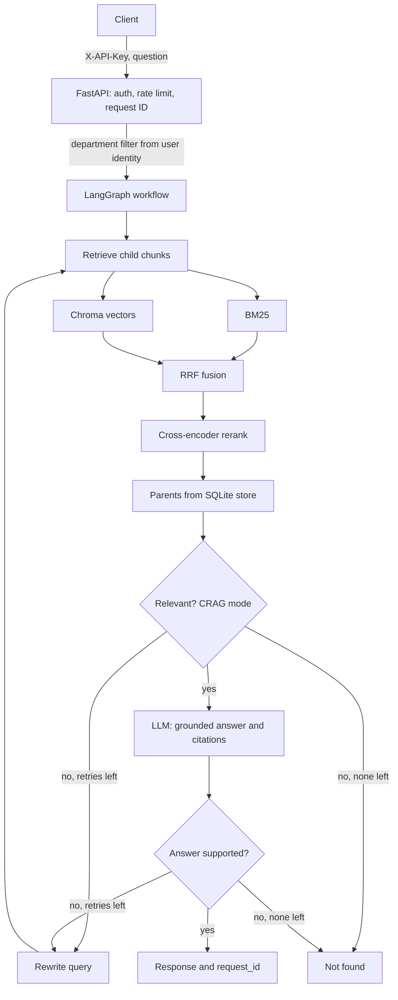

# Advanced RAG

A production-style Retrieval-Augmented Generation system built with Python, LangChain and LangGraph. It combines hybrid retrieval (BM25 + vector search), cross-encoder reranking, an optional corrective (CRAG) loop, grounded answers with validated citations, a measured evaluation harness, and a secured FastAPI service with document-level access control.

> **Status:** portfolio project. It is built to be understood, measured and defended, not to claim production-proven scale. See [Limitations](#limitations).

---

## Table of contents

- [Features](#features)
- [Architecture](#architecture)
- [Tech stack](#tech-stack)
- [Project structure](#project-structure)
- [Quick start](#quick-start)
- [Configuration](#configuration)
- [API](#api)
- [Evaluation](#evaluation)
- [Results](#results)
- [Security and privacy](#security-and-privacy)
- [Design decisions](#design-decisions)
- [Testing and CI](#testing-and-ci)
- [Limitations](#limitations)
- [Roadmap](#roadmap)

---

## Features

**Ingestion**
- Loaders for PDF, TXT, Markdown, HTML and CSV, with an extension allow-list, explicit UTF-8, text normalization and per-file error isolation
- Parent-child chunking: small child chunks are searched, larger parent chunks are sent to the LLM
- Recursive chunking by default, optional semantic chunking for parents (Urdu and English sentence endings supported)
- Deterministic hash-based IDs, so re-ingesting a document is idempotent
- Department metadata derived from the folder name, used for access control

**Retrieval**
- Local multilingual embeddings (normalized, batched, retried)
- Persistent Chroma index (cosine distance) plus a SQLite parent store
- In-memory BM25 over the same child chunks, with a Unicode and Urdu-aware tokenizer
- Reciprocal Rank Fusion (RRF) of BM25 and vector results
- Cross-encoder reranking, then unique parents ordered to reduce the "lost in the middle" effect

**Generation**
- Strict grounding prompt with a fixed "not found" phrase
- Numbered source blocks, delimiter stripping against prompt injection, per-source length cap
- Citations validated against real sources (invented numbers are dropped), with file and page taken from metadata
- Provider-independent LLM factory; the LLM call is skipped when nothing is retrieved

**Workflow**
- LangGraph workflow with typed state, conditional routing and per-node retry
- Optional CRAG mode: batched document grading, query rewriting, answer verification, a bounded retry loop and explicit final statuses

**Evaluation**
- Validated JSONL evaluation set with dev and test splits and six question categories (including unanswerable questions)
- Deterministic metrics: hit rate, MRR, full-hit rate, false and correct refusal rates, latency, LLM call count
- RAGAS metrics: faithfulness, answer relevancy, context precision and recall
- Ablation variants and a comparison tool with per-question changes and a regression check

**Service**
- FastAPI endpoints with request validation, hashed API keys, per-user rate limiting, bounded concurrency, request IDs and readiness checks
- Server-side, department-level access control applied to every retrieval path

---

## Architecture



**Ingestion flow**

```text
Files -> loaders -> normalization -> parent chunks -> child chunks
      -> embeddings -> Chroma (children) + SQLite (parents)
```

In `simple` mode the graph is `retrieve -> generate` (or a direct "not found" if nothing is retrieved). In `crag` mode the grading, rewrite and verification steps are added.

---

## Tech stack

| Area | Tools |
|---|---|
| Language | Python |
| Orchestration | LangChain, LangGraph |
| Vector store | ChromaDB (children), SQLite (parents) |
| Embeddings and reranking | sentence-transformers (local) |
| Keyword search | rank-bm25 |
| LLM | Provider-independent via `init_chat_model` (configured in `.env`) |
| Evaluation | RAGAS plus deterministic metrics |
| API | FastAPI, Uvicorn |
| Quality | pytest, ruff, GitHub Actions |

---

## Project structure

```text
advanced-rag/
├── app/
│   ├── api/                 # FastAPI app, schemas, auth, service, wiring
│   ├── bootstrap.py         # builds the heavy objects once
│   ├── chunking/            # parent-child and semantic chunking
│   ├── config/              # settings (pydantic-settings)
│   ├── embeddings/          # embedding model wrapper
│   ├── evaluation/          # dataset, runner, metrics, RAGAS, variants, compare
│   ├── generation/          # prompts, LLM factory, answer generation
│   ├── graph/               # LangGraph state, simple graph, CRAG graph, graders
│   ├── ingestion/           # document loaders
│   ├── reranking/           # cross-encoder and context ordering
│   ├── retrieval/           # BM25, RRF, hybrid retriever, parent retrieval, pipeline
│   ├── utils/               # logging with request IDs
│   └── vectorstore/         # Chroma wrapper, SQLite parent store
├── scripts/                 # ingest, ask, evaluation, key creation
├── tests/
├── data/
│   ├── raw/                 # your documents (not committed)
│   └── evaluation/          # evaluation set
├── .github/workflows/ci.yml
├── .env.example
├── requirements.txt
├── requirements-dev.txt
└── pyproject.toml
```

---

## Quick start

### 1. Install

```bash
python -m venv venv
# Windows:  venv\Scripts\activate
# Linux/macOS:  source venv/bin/activate
pip install -r requirements-dev.txt
```

### 2. Configure

```bash
cp .env.example .env      # Windows: copy .env.example .env
```

Set at least `LLM_PROVIDER`, `LLM_MODEL` and `LLM_API_KEY` in `.env`. Never commit `.env`.

### 3. Add documents

Put files under `data/raw/`. **The first folder name is the department** used for access control:

```text
data/raw/hr/leave_policy.pdf        -> department "hr"
data/raw/finance/expenses.pdf       -> department "finance"
data/raw/faq.txt                    -> department "public"
```

### 4. Ingest

```bash
python -m scripts.ingest
```

Re-run after changing documents, then restart any running API process so the in-memory BM25 index is rebuilt.

### 5. Ask from the command line

```bash
python -m scripts.ask "How many days of annual leave do employees get?"
python -m scripts.ask_crag "How many days of annual leave do employees get?"
```

### 6. Run the API

```bash
python -m scripts.create_api_key ali hr public     # a user limited to hr and public
python -m scripts.create_api_key admin "*"         # a user with access to everything
```

Add the printed entries to `config/api_keys.json` (a JSON list). Only key hashes are stored. Then:

```bash
uvicorn app.api.main:app --port 8000
```

```bash
curl -X POST http://localhost:8000/ask \
  -H "X-API-Key: YOUR_KEY" \
  -H "Content-Type: application/json" \
  -d '{"question": "How many days of annual leave do employees get?"}'
```

Windows `cmd`:

```text
curl.exe -X POST http://localhost:8000/ask -H "X-API-Key: YOUR_KEY" -H "Content-Type: application/json" -d "{\"question\": \"How many days of annual leave do employees get?\"}"
```

Interactive docs are available at `http://localhost:8000/docs` when `ENVIRONMENT=dev`.

---

## Configuration

All settings come from environment variables or `.env` (see `.env.example` for the full list).

| Variable | Purpose |
|---|---|
| `LLM_PROVIDER`, `LLM_MODEL`, `LLM_API_KEY` | Answer-generation model (provider package must be installed) |
| `GRADER_MODEL` | Optional cheaper model for CRAG graders (defaults to `LLM_MODEL`) |
| `EVAL_JUDGE_MODEL` | Optional separate model for RAGAS judging |
| `CHUNKING_STRATEGY` | `recursive` or `semantic` (parents) |
| `PARENT_CHUNK_SIZE`, `CHILD_CHUNK_SIZE` and overlaps | Chunk sizes in characters (baselines to tune) |
| `EMBEDDING_MODEL_NAME`, `RERANKER_MODEL_NAME` | Local models |
| `RETRIEVAL_TOP_K`, `BM25_TOP_K`, `HYBRID_FUSED_K`, `RRF_K` | Retrieval breadth and fusion |
| `RERANKER_CANDIDATES`, `RERANKER_TOP_K`, `RETRIEVAL_MAX_PARENTS` | Candidates and final context size |
| `CONTEXT_ORDERING` | `edges` or `best_first` |
| `RAG_MODE` | `simple` or `crag` |
| `CRAG_MAX_RETRIES` | Maximum rewrite attempts |
| `ENVIRONMENT` | `dev` (docs enabled) or `prod` |
| `RATE_LIMIT_PER_MINUTE`, `MAX_CONCURRENT_REQUESTS`, `QUEUE_WAIT_SECONDS` | Load protection |
| `API_KEYS_FILE` | Path to the hashed key file |

---

## API

| Method and path | Auth | Description |
|---|---|---|
| `POST /ask` | `X-API-Key` | Answer a question. Body: `{"question": "..."}` only. |
| `POST /ask/stream` | `X-API-Key` | Server-sent events: progress per graph node, then the final result. |
| `GET /health` | none | The process is alive. |
| `GET /ready` | none | Models are loaded and the index is not empty (503 otherwise). |

`POST /ask` response:

```json
{
  "request_id": "a3f9c1d27b04",
  "answer": "Employees get 20 days of paid annual leave per year [1].",
  "grounded": true,
  "status": "answered",
  "citations": [{"number": 1, "source": "hr/leave_policy.pdf", "page": 3}],
  "usage": {"input_tokens": 1520, "output_tokens": 64, "note": "answer-generation tokens only; grader and rewrite calls are not included"}
}
```

Status codes: `401` invalid key, `403` no document access, `422` invalid body (including any extra field such as `departments`), `429` rate limit, `502` LLM unavailable, `503` busy.

---

## Evaluation

The evaluation set is a JSONL file (`data/evaluation/eval_set.jsonl`). Each line has an `id`, `question`, a short `reference` answer, the `reference_sources` that contain it, a `category` (`direct`, `exact_id`, `paraphrase`, `roman_urdu`, `multi_doc`, `unanswerable`) and a `split` (`dev` or `test`).

```bash
python -m scripts.sample_for_eval 5     # random chunks to help write questions
python -m scripts.check_eval_set        # validates the file and that sources exist

python -m scripts.run_eval --variant vector_only
python -m scripts.run_eval --variant bm25_only
python -m scripts.run_eval --variant hybrid
python -m scripts.run_eval --variant hybrid_rerank
python -m scripts.run_eval --variant hybrid_rerank_edges
python -m scripts.run_eval --variant crag
python -m scripts.run_eval --variant hybrid_rerank --ragas   # adds the LLM-judged RAGAS metrics

python -m scripts.compare_runs vector_only bm25_only hybrid hybrid_rerank hybrid_rerank_edges crag
python -m scripts.compare_runs hybrid_rerank crag --tolerance 0.05 --fail-on-regression
```

**Method**
- Questions were written from the documents, not from system output.
- Variants differ in one component only; the generator, prompt and context budget are shared.
- Tune on `dev`; look at `test` once, for the final report.
- Deterministic metrics (hit rate, MRR, refusal rates) are cheap and exact. RAGAS uses an LLM judge, so small differences are treated as noise, and failed rows are reported.

---

## Results

> Fill this table with **your own measured numbers** and delete this note. Do not publish estimates.

Dev split, **N = ___** questions (one question = **___** points). Judge model: `___`. RAGAS version: `___`.

| Variant | Hit rate | MRR | False refusal | Faithfulness | Context recall | Median latency | LLM calls |
|---|---|---|---|---|---|---|---|
| vector_only | | | | | | | |
| bm25_only | | | | | | | |
| hybrid | | | | | | | |
| hybrid_rerank | | | | | | | |
| hybrid_rerank_edges | | | | | | | |
| crag | | | | | | | |

**Test split result for the chosen variant:** `___`

**Takeaways** (write three sentences from your data):
1. Largest gain came from: `___`
2. Gain within noise, kept optional: `___`
3. Weakest category: `___`

---

## Security and privacy

- **Authentication:** API keys are random and only their SHA-256 hashes are stored; comparison is constant-time. Raw keys are shown once at creation.
- **Access control:** the department filter is built on the server from the authenticated user, applied to both BM25 and vector search, and never read from the request (the schema forbids extra fields). A user with no departments sees nothing.
- **Prompt injection:** retrieved text is treated as untrusted data (delimited blocks, stripped look-alike tags, explicit instruction, no tools for the model). This reduces risk; it is not a guarantee.
- **Privacy:** logs record the question length and a hash, not the question text. The evaluation runs and evaluation set can contain document text and are gitignored.
- **Secrets:** `.env` and `config/api_keys.json` must never be committed.
- **Data sent to the LLM provider:** document text leaves your machine when an API-based LLM is used. Check your provider's terms for private documents.

---

## Design decisions

| Decision | Why | Trade-off |
|---|---|---|
| Parent-child chunks | Precise search on small chunks, enough context from large ones | Extra store and deduplication |
| Semantic chunking for parents only | Topic coherence where context matters; size control for children | Higher ingestion cost |
| Local multilingual embeddings | Free, private, supports Urdu | Short input limit, not retrieval-tuned |
| Hybrid BM25 + vector with RRF | Exact identifiers and paraphrases are covered; RRF avoids score normalization | BM25 index is in memory |
| Cross-encoder on a small candidate set | Higher precision where it matters | Added latency |
| Rerank children, send parents to the LLM | Fits the cross-encoder input limit while keeping context | Judge sees less text |
| LangGraph | Routing, bounded loops, persistence, streaming | More moving parts than a function |
| CRAG with prompted graders | Recovers from poor retrieval and unsupported answers | Up to 11 LLM calls per question |
| Server-side filter from identity | Clients cannot widen their own access | Department-level only |
| Deterministic metrics before RAGAS | Cheap, repeatable iteration | Source-level, not claim-level |

All chunk sizes, `top_k` values and reranking counts are baselines tuned on my own evaluation set, not universal values.

---

## Testing and CI

```bash
pytest -q
ruff check .
```

Unit tests use fake LLMs, retrievers and services, so they need no API keys, models or private documents. GitHub Actions runs lint and tests on every push and pull request.

The evaluation harness is run locally because it needs the private document corpus and an LLM judge. Use `compare_runs --fail-on-regression` to gate changes.

---

## Limitations

- The evaluation set is small. One question is worth several percentage points, so small differences are noise.
- RAGAS scores come from an LLM judge, which varies between runs and can be lenient or strict.
- BM25 is rebuilt in memory at startup, so it must be restarted after ingestion.
- Chroma and the SQLite parent store are single-node. The rate limiter is per process.
- Access control works at department level; it does not model per-document ACLs.
- Token usage in the API response covers answer generation only, not grader or rewrite calls.
- The default reranker is English-only; Urdu quality depends on the multilingual models chosen.
- PDF parsing has no OCR and handles tables poorly.
- Citation validation checks that a cited source exists, not that it supports the claim (faithfulness is measured separately).

---

## Roadmap

- Server-side vector database with native hybrid search for multi-node deployment
- Shared rate limiting and a managed secrets store
- Containerization and deployment configuration
- Per-document ACLs and optional PII redaction before the LLM call
- Full token and cost accounting across graph nodes
- Tracing (LangSmith or OpenTelemetry) and online feedback collection
- Growing the evaluation set from real failures

---

## License

Add your license here (for example MIT) and a `LICENSE` file.
